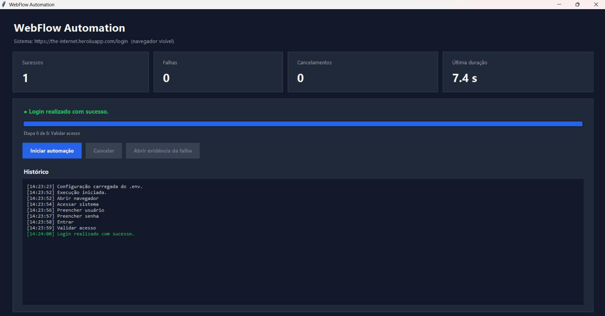
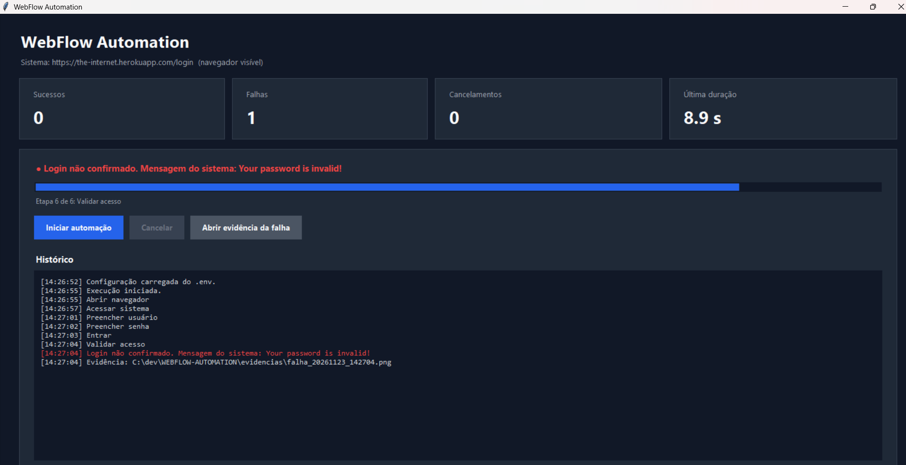

# WebFlow Automation

Robô de RPA em **Python + Playwright** com painel de controle em **Tkinter**: inicia, acompanha etapa por etapa e cancela uma automação de navegador sem travar a interface. Quando algo falha, salva um print da tela como evidência.



## Problema

Robôs de RPA costumam rodar como scripts de terminal: quem opera não vê o que está acontecendo, não consegue interromper com segurança e, quando algo falha, fica sem saber o que havia na tela. Pior: é comum encontrar usuário e senha escritos direto no código.

Este projeto resolve isso com:

- **Visibilidade:** painel com etapa atual, barra de progresso, histórico e indicadores de sucesso, falha e duração
- **Controle:** cancelamento a qualquer momento, atendido na hora
- **Rastreabilidade:** log em arquivo e print automático da tela em caso de falha
- **Segurança:** credenciais fora do código, em um arquivo `.env` que não vai para o Git

O fluxo automatizado é um login web completo com validação do resultado, executado no site [The Internet](https://the-internet.herokuapp.com/login), feito para praticar automação.

## Funcionalidades

- Login automatizado em 6 etapas: abrir navegador, acessar, preencher usuário, preencher senha, entrar e **validar o acesso**
- Painel com indicadores de sucessos, falhas, cancelamentos e duração da última execução
- Barra de progresso por etapa e histórico colorido por resultado
- Botão para abrir a evidência da última falha
- Execução pela linha de comando com **código de saída** (0 sucesso, 1 falha, 2 configuração inválida), pronta para agendamento
- Modo com navegador visível ou oculto (`headless`)
- Mensagens de erro em português e acionáveis (ex.: "Navegador do Playwright não instalado. Rode: playwright install chromium")



## Arquitetura

```
 dashboard.py (Tkinter)            login_automation.py (CLI)
        │                                   │
        │  Queue ◄── ao_avancar()           │
        │  Event ──► cancelar               │
        └──────────────┬────────────────────┘
                       ▼
                   robo.py  ──► Playwright (Chromium)
                       │
          ┌────────────┼──────────────┐
          ▼            ▼              ▼
     config.py    logs/automacao.log  evidencias/falha_*.png
     (lê o .env)
```

O robô não conhece a interface: recebe a configuração, avisa o andamento por um callback e obedece a um `threading.Event` de cancelamento. Por isso o mesmo código serve ao painel, à linha de comando e aos testes.

## Decisões técnicas

- **Robô separado da interface:** `robo.py` não importa Tkinter. O painel e a linha de comando são só formas diferentes de chamar `RoboLogin.executar()`, que devolve um `Resultado` (situação, mensagem, duração, evidência).
- **Robô em thread separada, comunicação por `Queue`:** o Tkinter não é thread-safe, então o robô nunca mexe na janela. Ele publica eventos numa fila, e a thread da interface os consome a cada 100 ms com `after()`.
- **Cancelamento com `threading.Event`:** as pausas entre etapas usam `Event.wait()` em vez de `time.sleep()`, então o pedido de cancelamento interrompe a espera na hora.
- **Credenciais no `.env`:** lidas com `python-dotenv`, validadas na inicialização e nunca escritas em log. A representação da configuração mascara a senha (`senha='***'`), para não vazar em mensagens de erro.
- **Evidência de falha:** em qualquer erro do Playwright ou validação não confirmada, o robô salva um print da página inteira antes de fechar o navegador.
- **Encerramento garantido:** o navegador é fechado em `finally`, em sucesso, falha ou cancelamento.
- **Seletores semânticos:** `get_by_label` e `get_by_role` no lugar de XPath ou CSS frágeis.
- **Validação do resultado:** sucesso só é reportado depois de confirmar a mensagem do sistema, não apenas porque o clique funcionou.
- **Log com rotação:** até 3 arquivos de 1 MB em `logs/`, para não crescer sem limite em execuções agendadas.

## Tecnologias


## Como executar

```bash
git clone https://github.com/johnatantech/WEBFLOW-AUTOMATION.git
cd WEBFLOW-AUTOMATION
python -m venv venv
```

Ative o ambiente virtual (`.\venv\Scripts\Activate.ps1` no Windows ou `source venv/bin/activate` no Linux/macOS) e instale as dependências e o navegador:

```bash
pip install -r requirements.txt
playwright install chromium
```

Crie o arquivo de configuração a partir do modelo:

```bash
# Windows
copy .env.example .env
# Linux / macOS
cp .env.example .env
```

O modelo já vem com as credenciais públicas do site de demonstração. Para usar em outro sistema, ajuste a URL e as credenciais no `.env`.

| Modo | Comando |
|---|---|
| Painel | `python dashboard.py` |
| Linha de comando | `python login_automation.py` |
| Linha de comando sem abrir o navegador | `python login_automation.py --headless` |
| Testes | `pip install -r requirements-dev.txt` e depois `pytest` |
| Só testes rápidos, sem internet | `pytest -m "not integracao"` |

## Configuração (`.env`)

| Variável | Obrigatória | Padrão | Descrição |
|---|---|---|---|
| `WEBFLOW_URL` | sim | | Página de login |
| `WEBFLOW_USUARIO` | sim | | Usuário |
| `WEBFLOW_SENHA` | sim | | Senha |
| `WEBFLOW_HEADLESS` | não | `false` | `true` executa sem abrir a janela do navegador |
| `WEBFLOW_DELAY_MS` | não | `800` | Pausa entre etapas, para acompanhar a execução |
| `WEBFLOW_TIMEOUT_MS` | não | `10000` | Tempo máximo de espera por elemento |

## Testes

- **Unitários:** leitura e validação do `.env`, mascaramento da senha, cancelamento e mensagens de erro
- **Integração** (marcados com `integracao`): rodam o robô de verdade, em modo oculto, no site de demonstração. Cobrem login com sucesso, senha errada gerando falha com evidência e cancelamento no meio da execução. São pulados automaticamente se o site estiver fora do ar.

## Estrutura

```
WEBFLOW-AUTOMATION/
├── robo.py               # robô de login: etapas, cancelamento, evidência e log
├── config.py             # leitura e validação do .env
├── dashboard.py          # painel Tkinter
├── login_automation.py   # linha de comando com código de saída
├── tests/
│   ├── test_config.py
│   └── test_robo.py
├── .env.example          # modelo de configuração (sem segredos reais)
├── pytest.ini
├── requirements.txt
├── requirements-dev.txt
└── .gitignore            # ignora .env, logs/ e evidencias/
```

## Próximos passos

- Agendamento pelo Agendador de Tarefas do Windows usando o código de saída
- Notificação por e-mail ou Teams quando uma execução falhar
- Leitura de credenciais de um cofre de segredos (ex.: Azure Key Vault) em vez do `.env`
- Suporte a vários fluxos cadastrados no painel

## Autor

**Johnatan Flores** · [GitHub](https://github.com/johnatantech) · [LinkedIn](https://www.linkedin.com/in/johnatan-flores-67595a221/)
